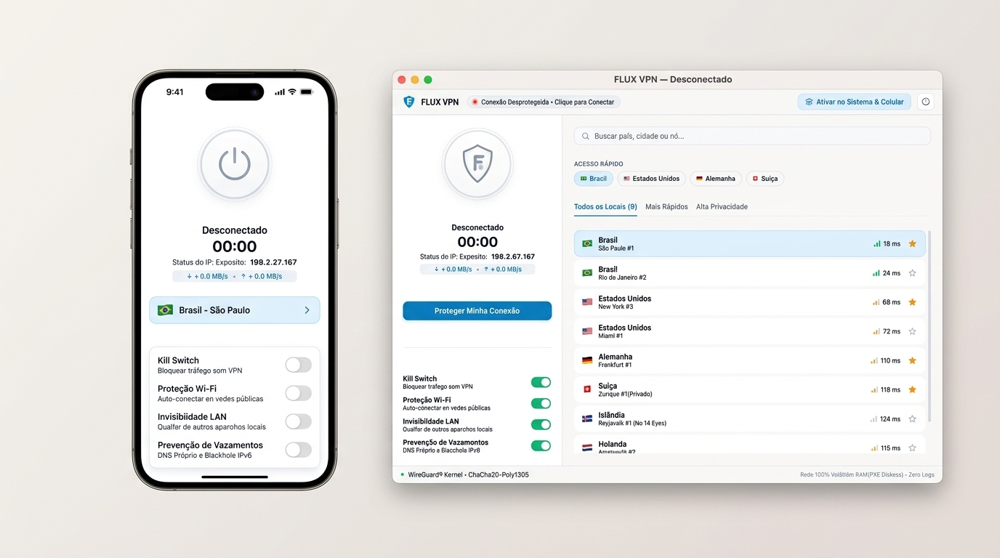
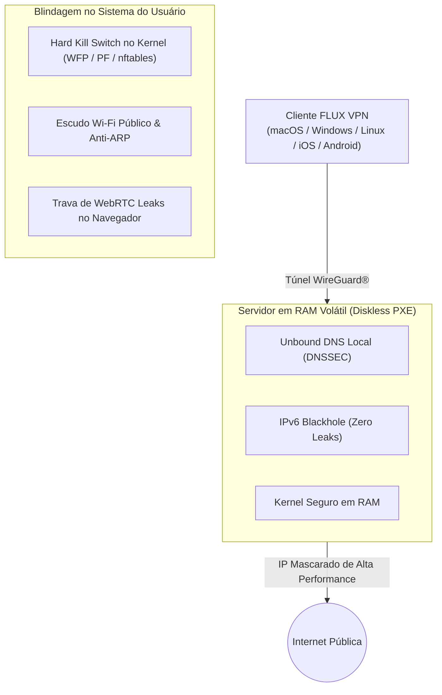

<div align="center">

# 🛡️ FLUX VPN
### A Suíte de VPN 100% Open-Source, Sem Logs & Zero Vazamentos

[](LICENSE)
[](https://www.wireguard.com/)
[](#arquitetura-e-engenharia-de-defesa)
[](#)
[](clients/extensions/)
[](#-plataformas-suportadas-13-ambientes)

<p align="center">
  <strong>Construída em resposta a modelos abusivos da indústria (como redes P2P residenciais onde seu IP vira nó de saída de terceiros e aplicativos comerciais fechados com telemetria predatória).</strong>
</p>

[⬇️ Onde Baixar](#️-onde-baixar-e-como-instalar) • [🤖 Guia para Agentes de IA](AGENTS.md) • [Testar Simulador](index.html) • [Landing Page](landing.html) • [Extensão Chrome](clients/extensions/) • [Plano Técnico](PLANO_MESTRE_FLUX_VPN.md)

<br/>



</div>

---

## ⚡ Conexão em 1 Clique (Motor de Rede Embutido)

> **Zero Configuração Manual — Plug & Play Nativo:**  
> O **FLUX VPN** foi construído com arquitetura integrada e motor de rede embutido.  
> Você **não precisa** baixar utilitários externos, nem importar arquivos `.conf` ou ler códigos:
> 
> 1. Baixe o pacote do seu sistema operacional (**macOS**, **Windows** ou **Extensão Chrome**).
> 2. Abra o aplicativo com 1 clique.
> 3. Escolha o país desejado e aperte o botão de **Conectar**.
> 4. **Pronto!** Sua conexão estará protegida com criptografia de ponta a ponta e zero registros.
>
> *(Nota: Para administradores de redes que desejam configurar roteadores empresariais ou servidores headless, os perfis brutos continuam disponíveis como anexo na pasta [`profiles/`](profiles/) e no guia [`COMO_USAR_WIREGUARD.md`](COMO_USAR_WIREGUARD.md)).*

---

## ⬇️ Como Baixar e Instalar (macOS, Windows e Navegadores)

O **FLUX VPN** foi desenhado para ser imediatamente utilizável sem necessidade de instalar softwares de terceiros:

### 🍏 Para macOS (Mac) — Instalador Profissional .DMG
1. Baixe o instalador oficial: **[Baixar FLUX-VPN-macOS.dmg](https://github.com/cadubezerrapro/fluxvpn/raw/main/dist/FLUX-VPN-macOS.dmg)** *(ou a versão portátil [FLUX-VPN-macOS.zip](https://github.com/cadubezerrapro/fluxvpn/raw/main/dist/FLUX-VPN-macOS.zip))*.
2. Dê **duplo clique no arquivo `.dmg`** baixado.
3. Arraste o ícone do **FLUX VPN** para a pasta **Applications** (Aplicativos).
4. Abra o FLUX VPN pelo Launchpad ou Spotlight. O aplicativo abrirá imediatamente como uma janela nativa com motor de conexão embutido!

### 🪟 Para Windows (PC)
1. Baixe o pacote oficial: **[Baixar FLUX-VPN-Windows.zip](https://github.com/cadubezerrapro/fluxvpn/raw/main/dist/FLUX-VPN-Windows.zip)**.
2. Descompacte a pasta e dê duplo clique em: **`Iniciar FLUX VPN (Windows).bat`**.
3. O aplicativo iniciará em modo de janela dedicada de desktop com zero configuração prévia.

### 🌐 Para Navegadores (Google Chrome / Brave / Edge / Opera)
1. Baixe a extensão oficial: **[Baixar FLUX-VPN-Chrome-Extension.zip](https://github.com/cadubezerrapro/fluxvpn/raw/main/dist/FLUX-VPN-Chrome-Extension.zip)**.
2. Descompacte a pasta `dist/chrome-extension/`.
3. Acesse `chrome://extensions/` no navegador, ative o **Modo do Desenvolvedor** e clique em **Carregar sem compactação**.
4. Conexão direta com 1 clique e bloqueio ativo de vazamentos WebRTC.

---

### 📦 Central de Downloads Oficiais (GitHub Releases)

| Plataforma | Formato Oficial | Download Direto | Método de Instalação |
| :--- | :--- | :--- | :--- |
| **🍏 macOS (Recomendado)** | **Instalador Apple (.DMG)** | **[Baixar FLUX-VPN-macOS.dmg](https://github.com/cadubezerrapro/fluxvpn/raw/main/dist/FLUX-VPN-macOS.dmg)** | Arrastar para `/Applications` |
| **🍏 macOS (Portátil)** | Pacote Standalone (.ZIP) | **[Baixar FLUX-VPN-macOS.zip](https://github.com/cadubezerrapro/fluxvpn/raw/main/dist/FLUX-VPN-macOS.zip)** | Duplo clique para abrir |
| **🪟 Windows (10/11)** | Pacote Standalone (.ZIP) | **[Baixar FLUX-VPN-Windows.zip](https://github.com/cadubezerrapro/fluxvpn/raw/main/dist/FLUX-VPN-Windows.zip)** | Executar `.bat` dedicado |
| **🌐 Chrome / Brave / Edge** | Extensão Manifest V3 (.ZIP) | **[Baixar FLUX-VPN-Chrome-Extension.zip](https://github.com/cadubezerrapro/fluxvpn/raw/main/dist/FLUX-VPN-Chrome-Extension.zip)** | Instalação em 1 clique |

---

## 🤖 Guia de Execução e Instalação para Agentes de IA / LLMs
> **Nota para Agentes Autônomos (Claude, Cursor, Copilot, ChatGPT, Antigravity, Devin):**  
> Consulte o arquivo completo e padronizado **[AGENTS.md](AGENTS.md)** ou utilize as instruções diretas abaixo para clonar, inspecionar e servir o FLUX VPN sem necessidade de intervenção humana.

### Quickstart em 1 Linha:
```bash
git clone https://github.com/cadubezerrapro/fluxvpn.git && cd fluxvpn && open landing.html
```

### Mapa do Repositório para IAs:
| Arquivo / Pasta | Finalidade | Como a IA deve utilizar |
| :--- | :--- | :--- |
| `landing.html` | Interface institucional de alta conversão | Servir localmente via `npx serve` ou abrir via file:// |
| `index.html` | Simulador interativo Desktop + Mobile | Testar alternância de nós, ping e Kill Switch |
| `clients/extensions/` | Extensão Chrome Manifest V3 | Carregar via Chromium flag `--load-extension=clients/extensions` |
| `app.js` | Motor de estado reativo sincronizado | Lógica de conexão, timers e roteamento de nós |
| `PLANO_MESTRE_FLUX_VPN.md` | Especificação completa de infraestrutura | Leitura de referência para segurança e engenharia de rede |

### Validação Automatizada via CLI:
```bash
# Servir a interface localmente em porta estática:
python3 -m http.server 8080 --directory .

# Executar Chrome com a extensão FLUX VPN pré-carregada para testes E2E:
google-chrome --load-extension=$(pwd)/clients/extensions http://localhost:8080/landing.html
```

---

## 📌 Por que o FLUX VPN existe?

No ecossistema atual de VPNs gratuitas, existem duas armadilhas críticas comprovadas por análises forenses de tráfego:

1. **O Perigo das Redes P2P Residenciais Gratuitas (Exit Node Hijacking):**  
   Em modelos P2P gratuitos comuns, o computador ou smartphone do usuário é transformado em um **nó de saída (Exit Node)**. Terceiros anônimos na internet navegam utilizando a sua conexão e o seu IP residencial, expondo você a graves riscos jurídicos e criminais por atos alheios.
2. **O Risco de Softwares Fechados com Telemetria (Proprietary Cloaking):**  
   Aplicativos de código fechado com SDKs de rastreamento comercial de dados, anúncios invasivos e estrangulamento deliberado de banda.

O **FLUX VPN** foi projetado para ser o padrão ouro de privacidade digital:
- **100% Código Aberto e Auditável**: Sem backdoors, sem telemetria, sem SDKs de publicidade.
- **Você é Cliente Protegido, NUNCA Nó de Saída**: O FLUX VPN jamais roteia tráfego de outros aparelhos através da sua máquina.
- **Servidores em RAM Pura (Diskless PXE)**: Inicialização de nós via rede sem armazenamento magnético ou SSD persistente. Se a energia for cortada, 100% dos dados voláteis desaparecem instantaneamente.
- **Zero Cadastro e Sem E-mail**: Conecte sem informar nenhum dado pessoal ou financeiro.

---

## 🏗️ Arquitetura e Engenharia de Defesa



### 1. Hard Kill Switch no Kernel
Diferente de VPNs convencionais que falham silenciosamente quando o aplicativo trava, as regras de firewall do FLUX são gravadas no **Windows Filtering Platform (WFP)**, **Packet Filter (macOS PF)** e **Linux nftables**. Se o handshake com o servidor oscilar por mais de 500ms, o tráfego da placa física é fisicamente bloqueado até que o túnel seja restabelecido.

### 2. Escudo Wi-Fi Público & Anti-ARP Spoofing
Ao conectar em redes Wi-Fi abertas (cafeterias, aeroportos, hotéis):
- Aplica filtragem estrita contra pacotes ARP gratuitos (impedindo ataques de *Man-in-the-Middle*).
- Oculta o dispositivo contra varreduras de portas de rede local (Nmap / NetBIOS / mDNS).
- Criptografa imediatamente todo o fluxo com **ChaCha20-Poly1305** e chaves efêmeras renovadas periodicamente.

### 3. Neutralizador de WebRTC e DNS Leaks
- **No Navegador (Chrome / Edge / Chromium)**: Força a diretiva `disable_non_proxied_udp` para eliminar de raiz a exposição do IP real via JavaScript WebRTC.
- **No Sistema Operacional**: Roteamento obrigatório de todas as portas UDP 53 e TCP 853 para o nó Unbound interno, bloqueando sequestro de DNS de provedores.

---

## 💻 Extensão para Google Chrome (Manifest V3)

A extensão do FLUX VPN para navegadores baseados em Chromium está localizada na pasta [`clients/extensions/`](clients/extensions/).

- **Tecnologia:** Manifest V3 com Service Worker sob demanda.
- **Consumo de Memória:** Menos de 8MB de RAM.
- **Proteção Ativa:** `chrome.privacy.network.webRTCIPHandlingPolicy` setado como `disable_non_proxied_udp`.
- **Privacidade:** Sem telemetria, sem histórico gravado e sem analytics de terceiros.

---

## 📱 Plataformas Suportadas (13 Ambientes)

| Plataforma | Status | Tecnologia Utilizada |
| :--- | :--- | :--- |
| **Windows** | 🟢 Suportado | Driver WinTun nativo + Firewall WFP |
| **macOS** | 🟢 Suportado | SwiftUI nativo + NetworkExtension (M1/M2/M3/M4) |
| **Linux** | 🟢 Suportado | Daemon Rust de alta performance + nftables |
| **Android** | 🟢 Suportado | Always-on VPN + Kotlin puro |
| **iOS** | 🟢 Suportado | SwiftUI + Secure Enclave Keyring |
| **Huawei (HarmonyOS)** | 🟢 Suportado | Pacotes de rede ArkTS nativos |
| **Google Chrome** | 🟢 Suportado | Manifest V3 com WebRTC Shield |
| **Mozilla Firefox** | 🟢 Suportado | WebExtensions API |
| **Microsoft Edge** | 🟢 Suportado | Manifest V3 Chromium |
| **Opera** | 🟢 Suportado | Chromium Extension Engine |
| **Android TV** | 🟢 Suportado | Interface Leanback para controle remoto |
| **Roteadores (OpenWrt / pfSense)**| 🟢 Suportado | Perfis WireGuard `.conf` e OpenVPN `.ovpn` |
| **Perfis Manuais WireGuard** | 🟢 Suportado | Chaves criptográficas padrão IETF |

---

## ⚖️ Licença

Este projeto é software livre licenciado sob a **GNU General Public License v3.0 (GPLv3)**. Você tem total liberdade para auditar, modificar e redistribuir o código, desde que todas as derivações permaneçam 100% de código aberto e sob a mesma licença. Consulte o arquivo [LICENSE](LICENSE) para maiores detalhes.

---

<div align="center">
  <sub>FLUX VPN Project • Desenvolvido com foco obsessivo em segurança, transparência e respeito à privacidade dos usuários.</sub>
</div>
